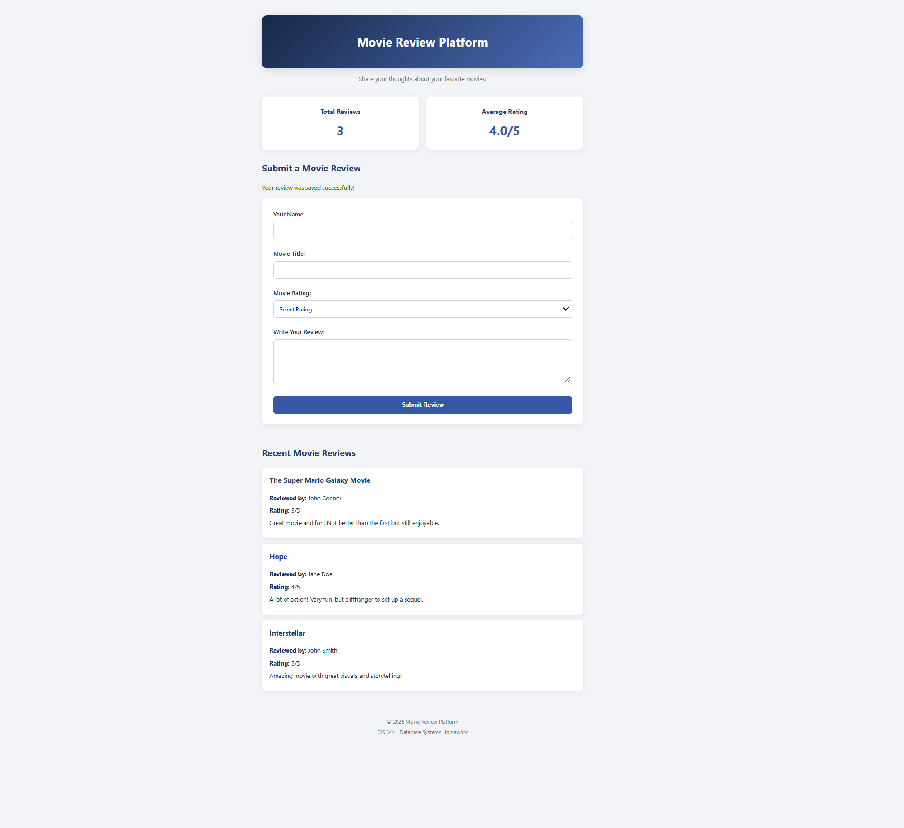
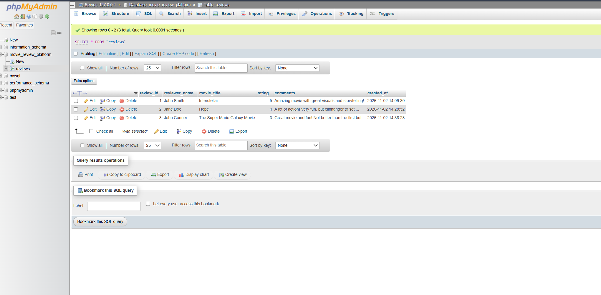

# Movie Review Platform

## Project Overview

The Movie Review Platform is a PHP and MySQL web application developed for CIS 344 at Lehman College.

The application allows users to submit movie reviews, rate movies, and view reviews submitted by other users.

The purpose of this project is to demonstrate PHP database connectivity, SQL operations, HTML form processing, and secure storage of user-submitted data.

## Technologies Used

- PHP
- MySQL
- HTML5
- CSS3
- XAMPP
- phpMyAdmin
- Visual Studio Code

## Features

- Submit movie reviews through an HTML form
- Rate movies on a scale of 1–5
- Save submitted reviews into a MySQL database
- Display recent movie reviews
- Calculate total reviews using SQL `COUNT()`
- Calculate average ratings using SQL `AVG()`
- Use prepared statements to prevent SQL injection
- Use reusable PHP header and footer files
- Responsive website design

## Database Structure

**Database:** `movie_review_platform`

**Table:** `reviews`

| Column | Data Type | Description |
|---|---|---|
| review_id | INT | Primary key, auto-increment |
| reviewer_name | VARCHAR(80) | Name of reviewer |
| movie_title | VARCHAR(120) | Movie being reviewed |
| rating | INT | Movie rating |
| comments | TEXT | Written review |
| created_at | TIMESTAMP | Submission timestamp |

## Installation Instructions

1. Install XAMPP.
2. Download or clone this GitHub repository.
3. Place the `movie-review-platform` folder inside `C:\xampp\htdocs`.
4. Open XAMPP and start Apache and MySQL.
5. Navigate to `http://localhost/phpmyadmin`.
6. Import the provided `database.sql` file.
7. Copy `config.example.php` and rename the copy to `config.php`.
8. Update the database credentials in `config.php` to match your local MySQL installation.
9. Open `http://localhost/movie-review-platform/index.php`.

## How the Application Works

1. The user enters their name, movie title, rating, and review.
2. The form sends the submitted information to `save_review.php` using the POST method.
3. PHP validates the information and connects to MySQL through `db.php`.
4. A prepared SQL INSERT statement saves the review in the database.
5. The user is redirected to the homepage.
6. SQL SELECT statements retrieve and display saved reviews.
7. SQL aggregate functions calculate the total reviews and average rating.

## Security Features

- PDO prepared statements for database operations
- Server-side input validation
- HTML output escaping
- Separate database configuration
- `.gitignore` protection for local credentials

## Unique Features

The application includes a responsive design, automatic review statistics, a recent reviews feed, and reusable PHP components.

## Application Screenshots

### Movie Review Platform Homepage

The homepage displays the movie review submission form,
total reviews, average rating, and recent movie reviews.

### MySQL Database Records

The following screenshot demonstrates that movie reviews
submitted through the PHP form are successfully saved
in the MySQL database.

## Course Information

**Course:** CIS 344 – Database Systems

**Institution:** Lehman College, CUNY

**Semester:** Fall 2026
